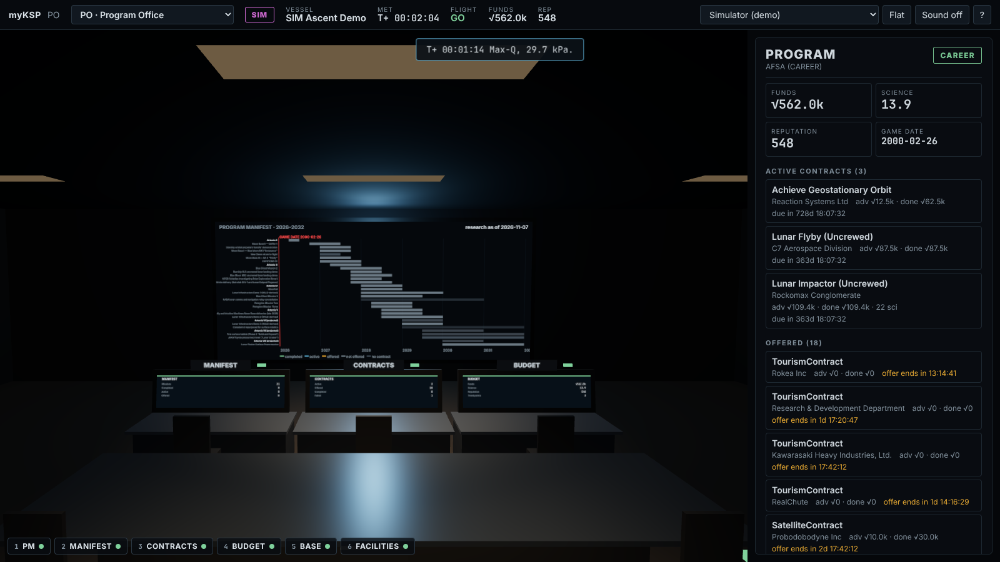
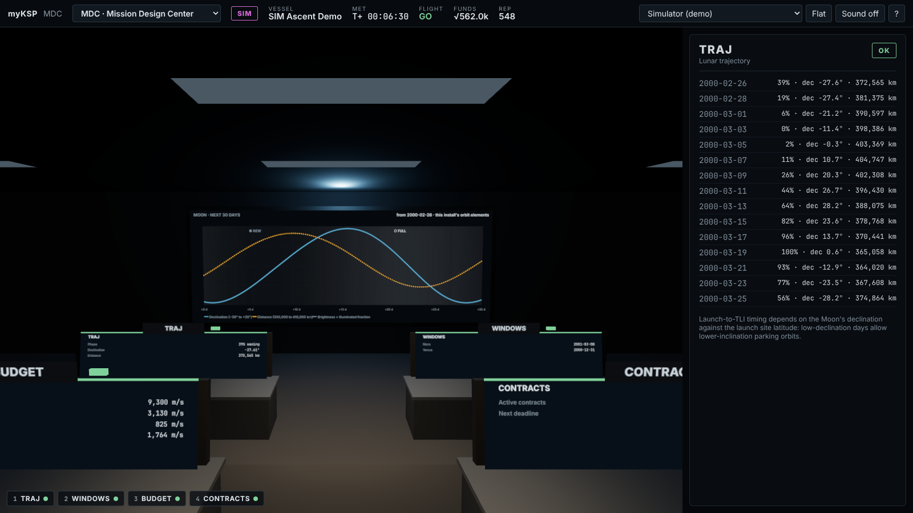
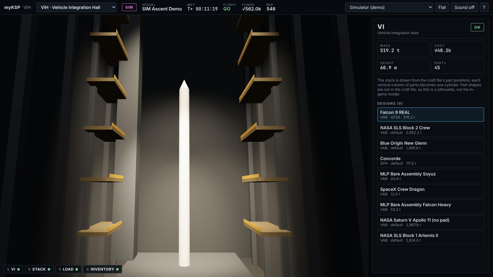
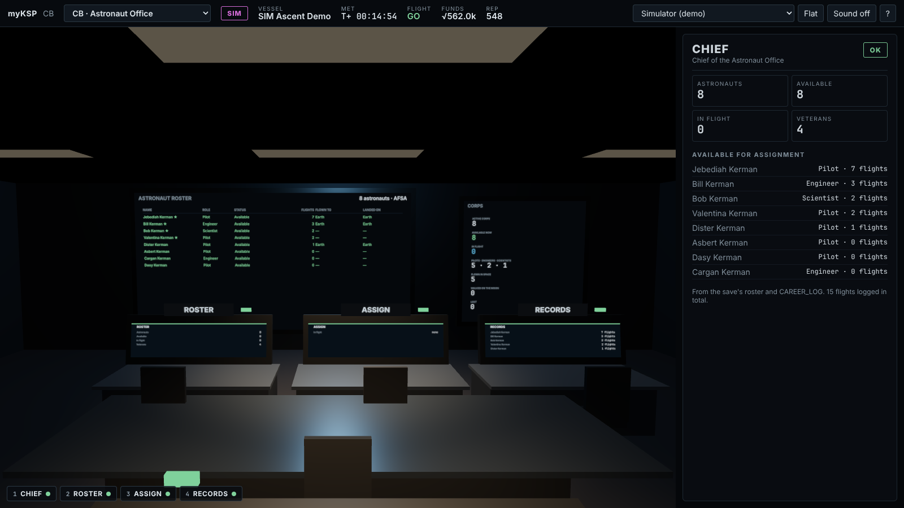
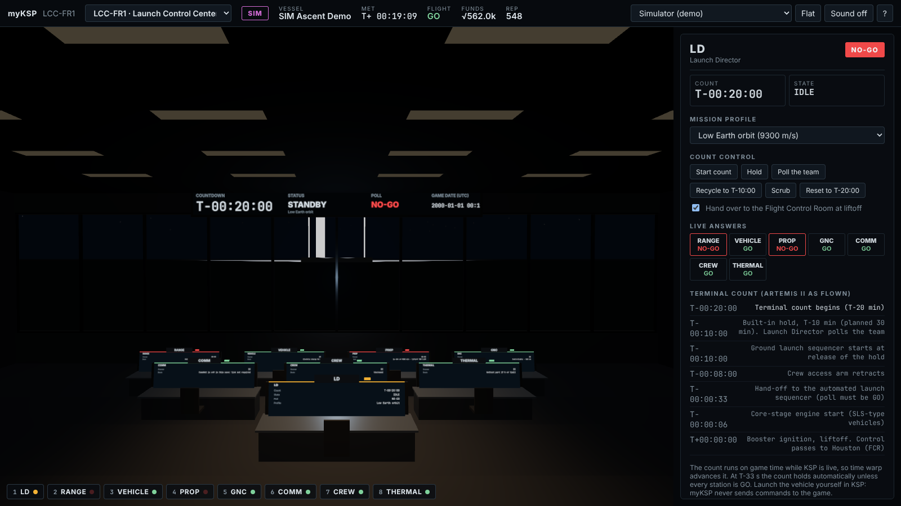
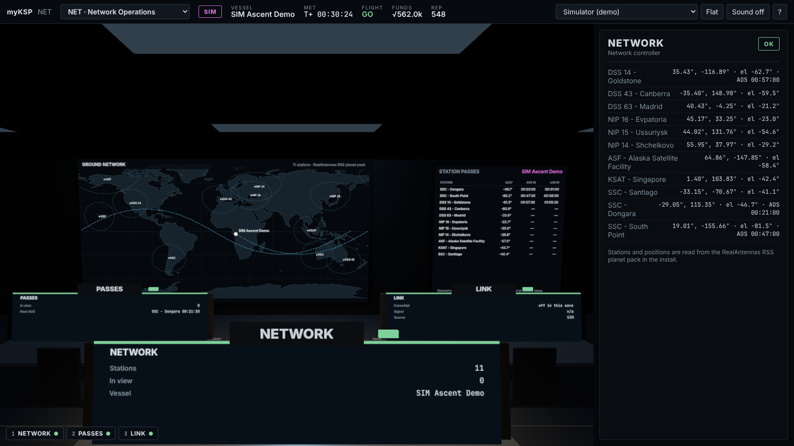
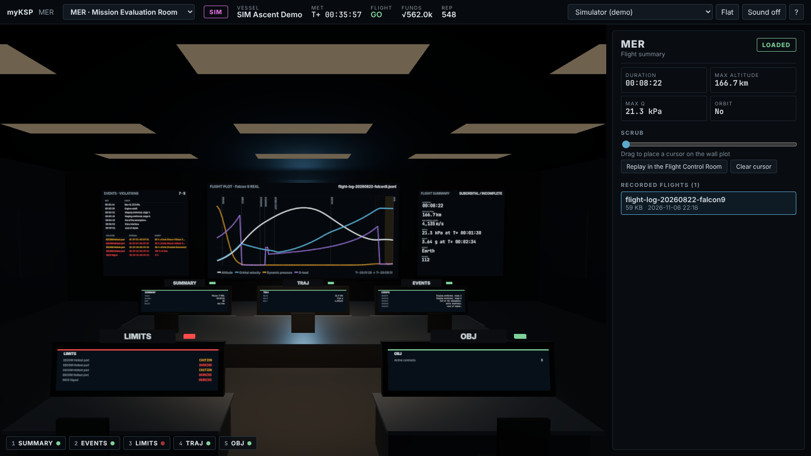
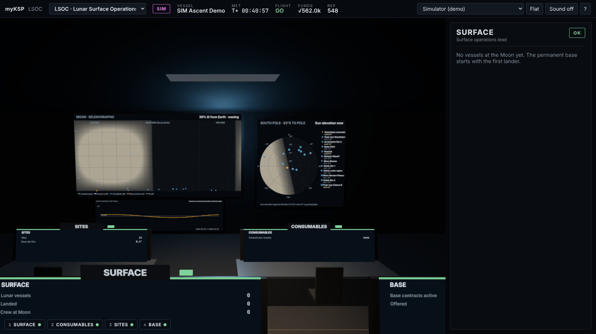

# Environments: how to run and what is verified

The environment design lives in [design.md](design.md); the backlog in [backlog.md](backlog.md).
Nine rooms are built, in the order a mission moves through them. Pick a room from the selector
at the top, or press **[** and **]**. The URL hash names the room (`#lcc`, `#mer` …).

| Room | Code | What it shows | Data |
|---|---|---|---|
| Program Office | PO | Manifest timeline 2026–2032 against the game date, contracts by program phase, funds/science/reputation trends, lunar base goal, facilities | Research manifest, contract metadata, save, save `Backup/` snapshots, bridge history log |
| Mission Design Center | MDC | Moon declination, distance and phase for 30 days; Mars and Venus departure windows; Δv budget (LEO, TLI, LOI, descent, TMI) against the live vehicle | RSS Kopernicus orbit elements from the install, Telemachus |
| Vehicle Integration Hall | VIH | 140 m high bay with the selected design stacked at true scale; design inventory with KSP's editor mass and cost; propellant and consumables load; TestFlight engine reliability for the selected design (each engine's ignition and rated-burn reliability, new and mature, and the odds that every engine works) | `Ships/` and per-save craft files, `.loadmeta`; TestFlight data from `RealismOverhaul/Engine_Configs` and `*TestFlight*.cfg`, joined on the craft's engine config |
| Astronaut Office | CB | Roster, status, flights, bodies flown to and landed on, assignments, availability | Save roster and `CAREER_LOG` |
| Launch Control Center | LCC-FR1 | Terminal count (Artemis II structure: built-in hold at T-10 min, auto-sequence at T-33 s), GO/NO-GO poll answered from live data, vehicle on the pad | Telemachus; count runs on game time |
| Flight Control Room | FCR-1 | Live flight (Phase 1 slice) | Telemachus |
| Network Operations | NET | RealAntennas ground stations, coverage footprints, elevation now and predicted AOS/LOS | RealAntennas RSS planet pack, Telemachus |
| Mission Evaluation Room | MER | Scrub any recorded flight: plot, events, limit violations, contract objectives; replay in the FCR | Bridge recordings |
| Lunar Surface Operations | LSOC | Lunar assets, manifest base sites, Sun elevation at each site (south-pole view), TAC LS days remaining, base contracts | Save, research manifest, orbit elements, TAC LS rates from the save |

Every room says plainly when it has no data. Nothing in any room sends commands to KSP.


## Run it on the iMac

```sh
cd ~/Projects/myKSP
npm install
npm start            # builds the front end, starts the bridge on http://127.0.0.1:8787
```

Open <http://127.0.0.1:8787>. For development with hot reload use `npm run dev` (bridge on 8787,
front end on <http://127.0.0.1:5173>).

| Setting (env var) | Default | Meaning |
|---|---|---|
| `KSP_ROOT` | `/Applications/KSP-RP2000` | KSP install; saves are read from `saves/`, legacy flight logs from `_AgentDocs/` |
| `TELEMACHUS_URL` | `ws://127.0.0.1:8085/datalink` | Telemachus datalink |
| `TELEMACHUS_RATE_MS` | `250` | Subscription rate |
| `MYKSP_PORT` / `MYKSP_HOST` | `8787` / `127.0.0.1` | Bridge address. Loopback by default because it serves save data; set `MYKSP_HOST=0.0.0.0` to use a tablet on the LAN |
| `MYKSP_MODE` | `live` | Start in `live`, `sim` or `replay` |
| `MYKSP_SIM_SPEED` | `1` | Time multiplier for the simulator |
| `MYKSP_RECORDINGS` | `data/recordings` | Where live flights are recorded (JSONL) |

## Using the room

* **Consoles:** click a console or press **1–8** (FLIGHT, FDO, GNC, PROP, EECOM, INCO, CAPCOM,
  PROGRAM). **Esc** returns to the overview seat, **Tab** cycles, **F** toggles flat mode,
  **M** sound (Quindar tones on callouts, master caution on new warnings), **I** performance HUD, **?** help.
* **Source** (top right): *Live (KSP)*, *Simulator (demo)*, or any recorded flight. SIM and
  REPLAY are always badged magenta and are never presented as live data.
* **Front wall:** ground track with flown path and a predicted 1.5-revolution track, altitude
  and velocity against MET, orbit diagram drawn to scale, and a clock strip (MET, flight day,
  RSS game date, next apsis, link state).
* **Program board** (FCR console 8): funds, science, reputation, active and offered
  contracts with due dates, crew, vessels, facility levels, from the newest career save. **P**
  opens the Program Office, **L** the Launch Control Center.
* **Planning data:** the Program Office, Mission Design Center and Lunar Surface Ops read
  `docs/research/artemis-manifest.json` (research thread) and `contracts/manifest/contract-meta.json`
  (contracts thread). Until those branches merge, copy the two files into `data/vendor/`
  (gitignored) and the bridge picks them up.


| | |
|---|---|
|  |  |
|  |  |
|  |  |
|  |  |

Screenshots: headless Chromium, software GL, SIM source with a copy of the AFSA career save (game date 2000-02-26).

## Verification status, all rooms (2026-11-07)

| Item | Status |
|---|---|
| Unit tests (`npm test`) incl. new: body config parsing, Kepler propagation, Earth→Mars Hohmann (Δv 2.9–3.0 km/s, 255–262 d) and windows one synodic period apart, lunar Sun elevation, ground-station parsing and elevation, craft and loadmeta, countdown holds and auto-sequence hold, liftoff only during an active count, flight analysis, TAC LS rates, TestFlight parsing (RO nested and RP2000 top-level blocks) and engine grouping | **Pass**, 33 tests |
| Against the install copy: Sun declination −23.1° on 2000-01-01 and +23.4° on 21 June; next Mars window 2026-12-02 | **Pass** |
| `scripts/rooms.mjs`: every room loads in headless Chromium against the bridge, with no page errors | **Pass**. Draw calls 13–87, CPU 0.5–5.5 ms per rendered frame in software GL |
| Bridge against the real install on the iMac (read-only, KSP untouched) | **Pass**: epoch 2000-01-01 from RSSDateTimePatch.cfg, 33 bodies, 11 RealAntennas stations, 138 craft, TAC LS rates and CommNet off read from the save, manifest (31 missions, 14 sites) and contract metadata (30) loaded, Falcon 9 recording analysed (7 events, 5 violations). Found and fixed: the release bundle resolved the repo folder wrongly, so planning data and the front end were missing when started without run.sh |
| Rooms in the live game on the iMac, main menu (2026-11-07, release bundle, Chrome) | **Pass.** All nine rooms load against the running game (KSP at the main menu, save copy MKSP_Test2) with no page errors; 13 to 87 draw calls per room; CommNet-off read from the save. Cost alongside KSP: bridge 0.1–0.2% CPU, 56–86 MB; Chrome 8–12% CPU. The only console error was a missing favicon, since fixed |
| TestFlight reliability against the real install (2026-11-07) | **Pass.** 803 engine configs indexed (first call 554 ms, then about 6 ms); all nine MKSP_Test2 VAB craft resolve; Merlin1D and J-2-230K match the raw configs exactly; Saturn V 55% new / 92% mature recomputed by hand. Found and fixed: engines saved with no engine module (Apollo LES, APS) were left out |
| Rooms on a real flight ("Oh Yeah!", Intelsat-1 in Earth orbit), replayed from its live recording | **Pass** with one fix. NET elevations match a hand calculation from the subpoint within 0.1°; LINK correctly says CommNet is off; MDC Δv matches the recording; MER found orbit insertion and the low-Δv caution. Found and fixed: the LCC offered a count for a vehicle already in orbit |
| Rooms live against a game in flight | **Not yet done.** KSP crashed during the attempt seconds after a test bridge reconnected to Telemachus, right after another was killed without a clean close. The bridge now unsubscribes and sends a WebSocket close frame on shutdown (checked against a stand-in server). Rule: never start or stop a bridge while a flight is in progress |

## Verification status, Flight Control Room (2026-11-06)

| Item | Status |
|---|---|
| Unit tests (`npm test`): ConfigNode parser, career summary, Telemachus normalization incl. "NaN" strings and the 0 Δv quirk, limit checks, event detection, simulator reaches orbit, Telemachus client subscribe/stage-key/reconnect against a fake datalink | **Pass**, 18 tests |
| Career parser on the real `AFSA` save (1.48 MB, 3 active + 18 offered contracts, 57 roster entries) and `Artemis` save | **Pass**, 149 ms for AFSA; set `MYKSP_REAL_SAVE` to re-run |
| Replay of the 2026-08-22 Falcon 9 log from `_AgentDocs` through the bridge | **Pass** (Max-Q and engine cutoff called). That log has no lat/lon or attitude, so those show "no data" |
| Room renders in headless Chromium (software GL), SIM ascent to orbit, callouts, flat mode, program board | **Pass** (screenshots above; `npm run smoke`) |
| Render cost | 82 draw calls, about 1k triangles, about 1.5 ms CPU per rendered frame in software GL. Renders only on new data (≈4 Hz) or camera moves. GPU time on the iMac with KSP running is **not yet measured** |
| **Live Telemachus feed on the iMac** (Mike's craft in Earth orbit, "default" sandbox, 17:21) | **Pass.** Badge LIVE; one websocket frame matched a direct Telemachus query on body, Ap 7,958,196 m, Pe 378,392 m, inclination 28.4213°, period 10,767.83 s, EC 32,915/42,450, signal, paused, situation, stage count, Δv 66.6 m/s, mass 14.9 t. Altitude differed by 466 m because the craft was climbing between the two reads. FDO panel GO: "Pe 378.4 km clear of atmosphere". Main menu correctly showed NOT IN FLIGHT. Bridge log had no errors |
| Live recording | **Pass.** A JSONL recording started by itself when the flight began, at about 3.2 lines a second (397 lines when stopped) |
| Cost on the iMac with KSP in flight | Bridge 0.1–0.3 % CPU, 35–45 MB. KSP 83–85 % CPU and about 23 GB in flight. The room in the Claude app's browser pane: about 22 % (GPU helper) + 11 % (page), which includes the app itself. **Not measured:** visible vs hidden tab (that pane never reports the page hidden; needs Chrome or Safari) and KSP's own FPS |
| Issues found live, fixed in this change | Number keys ignored after using the source picker (it kept keyboard focus); wall screens lagged the side panel by up to about 7 s when the flight scene started (they now redraw at once on a state change); "No Target Selected." shown as a target name with 0 m range (now no target). Fixes are unit-tested or type-checked, **not yet re-checked live** |
| Open | INCO reads WARNING, signal 0 %: Telemachus itself reports 0, so this is real data. Check whether CommNet is off in that save. The iMac is short on memory (swap nearly full, startup disk 99 % full), which matters more than the room's cost in a long session |

## Limitations to know

* Read-only by design: no commands are sent to KSP. Telemachus' command endpoints are
  unauthenticated, so commanding waits for an authenticated path (kRPC or our own mod).
* Maneuver nodes are not shown: those Telemachus keys throw in this build.
* Telemachus ignores RealAntennas, so a comm blackout does not dim the room yet.
* Game date comes from the install's RSSDateTime epoch (RP2000: UT 0 = 2000-01-01).
* Transfer windows are Hohmann (circular, coplanar): real porkchop minima differ by days to weeks.
  Ground-station passes are geometry only (0° mask, current altitude held); RealAntennas link
  budgets are not exposed by Telemachus. Lunar Sun elevation ignores libration (±1.5°).
* Surface assets and consumables are as of the last save: Telemachus reports only the active vessel.
* The vehicle stack in VIH and LCC is a silhouette built from part positions (the craft file has
  no part shapes).
* The simulator is a two-stage point-mass model for demos and tests, not a flight model.

## Launching and quitting KSP

`tools/ksp/launch-ksp.sh` starts KSP once (no-op if it is already running, lock against two
callers) and waits for the main menu. Loading takes 10–14 minutes on the iMac; a long quiet
stretch is normal, and `~/Library/Logs/Squad/KSP/Player.log` is more current than `KSP.log`.
`tools/ksp/quit-ksp.sh` quits without saving (polite quit, then SIGTERM, then SIGKILL). Never run
it while someone is playing. Back up the save before any test that touches it.
