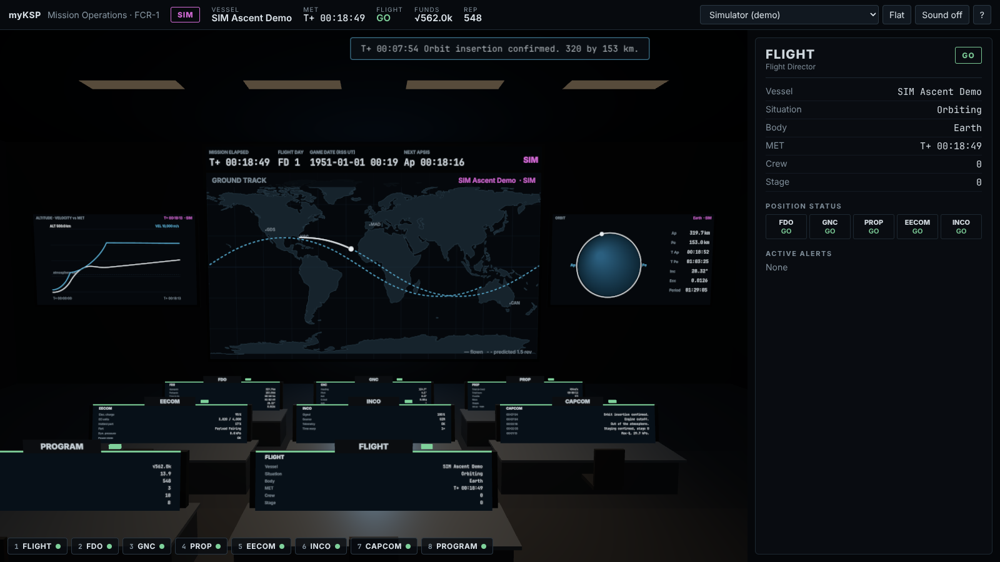
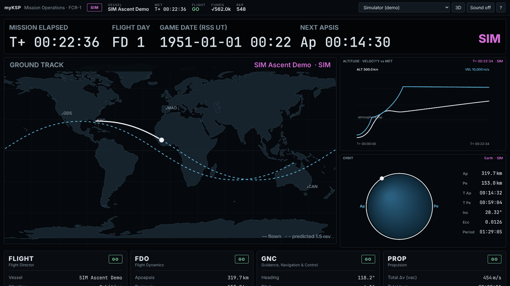

# Environments: how to run and what is verified

The environment design lives in [design.md](design.md); the backlog in [backlog.md](backlog.md).
This page covers the Phase 1 vertical slice: the **Flight Control Room (FCR-1)**.



## Run it on the iMac

```sh
cd ~/Projects/myKSP
npm install
npm start            # builds the front end, starts the bridge on http://127.0.0.1:8787
```

Open <http://127.0.0.1:8787>. For development with hot reload use `npm run dev` (bridge on 8787,
front end on <http://127.0.0.1:5173>).

| Setting (env var) | Default | Meaning |
|---|---|---|
| `KSP_ROOT` | `/Applications/KSP-RP2000` | KSP install; saves are read from `saves/`, legacy flight logs from `_AgentDocs/` |
| `TELEMACHUS_URL` | `ws://127.0.0.1:8085/datalink` | Telemachus datalink |
| `TELEMACHUS_RATE_MS` | `250` | Subscription rate |
| `MYKSP_PORT` / `MYKSP_HOST` | `8787` / `127.0.0.1` | Bridge address. Loopback by default because it serves save data; set `MYKSP_HOST=0.0.0.0` to use a tablet on the LAN |
| `MYKSP_MODE` | `live` | Start in `live`, `sim` or `replay` |
| `MYKSP_SIM_SPEED` | `1` | Time multiplier for the simulator |
| `MYKSP_RECORDINGS` | `data/recordings` | Where live flights are recorded (JSONL) |

## Using the room

* **Consoles:** click a console or press **1–8** (FLIGHT, FDO, GNC, PROP, EECOM, INCO, CAPCOM,
  PROGRAM). **Esc** returns to the overview seat, **Tab** cycles, **F** toggles flat mode,
  **M** sound (Quindar tones on callouts, master caution on new warnings), **I** performance HUD, **?** help.
* **Source** (top right): *Live (KSP)*, *Simulator (demo)*, or any recorded flight. SIM and
  REPLAY are always badged magenta and are never presented as live data.
* **Front wall:** ground track with flown path and a predicted 1.5-revolution track, altitude
  and velocity against MET, orbit diagram drawn to scale, and a clock strip (MET, flight day,
  RSS game date, next apsis, link state).
* **Program board** (console 8 / **P**): funds, science, reputation, active and offered
  contracts with due dates, crew, vessels, facility levels, from the newest career save.



## Verification status (2026-11-06)

| Item | Status |
|---|---|
| Unit tests (`npm test`): ConfigNode parser, career summary, Telemachus normalization incl. "NaN" strings and the 0 Δv quirk, limit checks, event detection, simulator reaches orbit, Telemachus client subscribe/stage-key/reconnect against a fake datalink | **Pass**, 17 tests |
| Career parser on the real `AFSA` save (1.48 MB, 3 active + 18 offered contracts, 57 roster entries) and `Artemis` save | **Pass**, 149 ms for AFSA; set `MYKSP_REAL_SAVE` to re-run |
| Replay of the 2026-08-22 Falcon 9 log from `_AgentDocs` through the bridge | **Pass** (Max-Q and engine cutoff called). That log has no lat/lon or attitude, so those show "no data" |
| Room renders in headless Chromium (software GL), SIM ascent to orbit, callouts, flat mode, program board | **Pass** (screenshots above; `npm run smoke`) |
| Render cost | 82 draw calls, about 1k triangles, about 1.5 ms CPU per rendered frame in software GL. Renders only on new data (≈4 Hz) or camera moves. GPU time on the iMac with KSP running is **not yet measured** |
| **Live Telemachus feed into this bridge** | **Not verified in this session.** The cloud container cannot reach the Mac's port 8085 and KSP was not running. The bridge uses only keys an earlier session verified live on this install. First check: start KSP, launch anything, open the room, confirm the badge reads LIVE |

## Limitations to know

* Read-only by design: no commands are sent to KSP. Telemachus' command endpoints are
  unauthenticated, so commanding waits for an authenticated path (kRPC or our own mod).
* Maneuver nodes are not shown: those Telemachus keys throw in this build.
* Telemachus ignores RealAntennas, so a comm blackout does not dim the room yet.
* Game date assumes the RSS/RP-1 epoch (UT 0 = 1951-01-01). Saves with another epoch will show a
  wrong calendar date; MET is unaffected.
* The simulator is a two-stage point-mass model for demos and tests, not a flight model.
